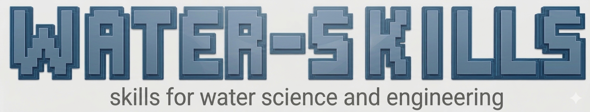

<p align="center">
  
</p>

[](LICENSE)
[](https://discord.gg/k49cHHrce)

# water-skills

Agent skills for water science and engineering. The repository transfers practical engineering knowledge—assumptions, checks, software procedures, failure signatures, and limits—into concise instructions an agent can apply with a human engineer.

Skills are procedures, not endorsements that a model, simulation, or engineering decision is correct. Review each skill's scope and assumptions before using it. Successful parsing, software execution, and format validation do not establish calibration, field agreement, or scientific validity.

## Use a skill

1. Browse the `skills/` directory and read the selected `SKILL.md` and any linked references.
2. Check its required software, inputs, units, and limitations.
3. Load the skill using your agent host's documented method. This repository does not currently provide a project-specific installer.
4. Review the result against the task's data, criteria, and applicable engineering requirements. Keep domain decisions with qualified people.

## Agent skills (Stage 7)

The repository includes nine narrowly scoped sub‑agents that enforce repository policy, validate contributions, and support the contribution workflow. Each agent:

- Runs only the checks its description lists.
- May read files and execute read‑only commands; **never** edits `AGENTS.md`, `LICENSE`, `main`, or creates tags/releases.
- Posts plain‑language results to the PR or issue thread and stops.

The nine agents (created per Q3‑Q8 decisions):

| Agent | Purpose |
|---|---|
| `agents/repository-validator.md` | Runs full health checks (validate‑skills, catalog, tests, links, secrets) and posts a summary comment. Never modifies or approves. |
| `agents/docs-link-maintainer.md` | Checks that all docs links resolve, catalog is in sync with `skills/`, and reports broken routes. Never modifies. |
| `agents/eval-maintainer.md` | Runs `python evals/runner.py --validate`, lists suites, inspects captured‑run metadata, generates a report. Never launches captures or model‑graded assertions. |
| `agents/intake.md` | Reads a `propose-skill.yml`/`propose-skill.md` issue, applies triage labels (`accepted`/`declined`/`needs-info`), and posts a decision. Never opens a branch or PR. |
| `agents/scaffold.md` | Runs `water-skills new --from-issue <number>` and outputs the branch name, file list, and draft‑PR instructions for browser review. Never opens a PR or merges. |
| `agents/review.md` | Reviews a draft PR's `SKILL.md`, `provenance.yaml`, `evals/evals.json`; checks units, assumptions, method, citations, and eval adherence. Returns `accept`/`request‑changes`/`decline`. Never merges. |
| `agents/eval.md` | Validates eval specs and reports captured runs; identical mandate to `eval-maintainer.md` (kept for explicit PR‑level use). |
| `agents/curation.md` | Checks catalog sync, provenance records, staleness (`last_reviewed > 180 d`), and skill layout compliance. Posts a summary; never modifies skill files. |
| `agents/release.md` | Enforces `RELEASING.md` human gate: one‑repository SemVer, CHANGELOG entry check, tag non‑existence, `main` safety. Never auto‑tags or publishes. |

All agents follow `contributing/AGENT_TEMPLATE.md` – `mode: subagent`, `permission: edit: ask, bash: ask, task: deny`. They are **read‑only** by design; intake/scaffold agents remain recommendation‑only until a no‑git pilot is completed (see Pilot section).

## Contribute new skills (full workflow)

### 1. Propose via issue form (no git required)

- Open the **Issues** tab, choose **New issue**, and select **Propose a skill**.
- Fill the required fields: `domain`, `problem`, `prompt`, `expected`, `inputs`, `software`, `references`, and optionally a redacted `transcript`.
- A maintainer triages the issue using labels from `contributing/ISSUE_TRIAGE.md` (`proposal` → `accepted`/`declined`/`needs-info`).

### 2. Scaffold (maintainer runs)

- If accepted, a maintainer runs:
  ```bash
  water-skills new --from-issue <number> --dry-run   # review planned output
  water-skills new --from-issue <number>             # creates branch + SKILL.md + provenance.yaml + evals/evals.json
  ```
- The command prints the branch name, created files, and any unresolved questions.

### 3. Browser review (contributor)

- A draft pull request appears on GitHub. The contributor reviews it **in the web UI only** – no terminal needed.
- The contributor can comment on the draft; a maintainer converts it from **draft → ready → merge** after domain review.

### 4. Domain review (named expert)

- A domain expert reviews the merged PR for units, assumptions, method, citations, and eval adequacy.
- Decision: `accept` / `request‑changes` / `decline`. Changes are applied in new commits on the same branch.

### 5. Release gate (maintainer)

- Before tagging, a maintainer runs the release pre‑check (see Release agent above).
- If all checks pass, the maintainer tags `vX.Y.Z` on `dev` and pushes; GitHub Pages rebuilds automatically.

### 6. Checklist for every contribution

- [ ] Issue form filled with all required fields.
- [ ] Triage label `accepted` applied by a maintainer.
- [ ] `water-skills new --from-issue` output reviewed; branch + files created as expected.
- [ ] Draft PR reviewed in browser; contributor confirms understanding.
- [ ] `bash .github/workflows/validate-skills.sh` passes (9 skills validated, catalog current, links OK, secrets clean).
- [ ] Domain expert sign‑off on method, citations, and eval adequacy.
- [ ] Maintainer releases per `RELEASING.md` human gate.

## Update existing skills

- Edit the `SKILL.md` frontmatter or body directly in the skill directory.
- Run `agentskills validate ./skills/<name>` to confirm frontmatter schema.
- Run `python evals/runner.py --validate` to confirm `evals/evals.json` passes the V1 contract.
- Commit changes on `dev`; a maintainer opens a PR, applies the same review/release gate as a new skill.

## Evaluation options

| Option | Command | What it does |
|---|---|---|
| **Validate spec** | `python evals/runner.py --validate` | Lints every eval spec (JSON parses, `skill_name` matches directory, required fields present). No model calls, no network. |
| **List suites** | `python evals/runner.py --list` | Discover all eval suites and their cases. |
| **Run a single skill** | `python evals/runner.py --skill <name> --all-conditions` | Render and grade captured runs for one skill. |
| **Check catalog** | `python scripts/generate_catalog.py --check` | Verify generated catalog matches `catalog/catalog.json`. |
| **Staleness report** | `python scripts/check_staleness.py` | Report skills whose `last_reviewed` is >180 d old or `review_status` is `not_reviewed` without justification. |

**Behavioural disclaimer:** Grading captured artifacts does **not** establish scientific or domain correctness. It only confirms that the artifact format is valid and the metadata fields are present.

## Pilot (no‑git contribution without terminal)

A pilot with a water‑engineer contributor who has no git experience is documented in `src/content/docs/guides/pilot-plan.md`. The pilot measures whether the issue‑form → scaffold → draft‑PR → review pathway works without the contributor needing a terminal. After the pilot, the runway status can be updated from `designed, not validated` to `supported`.

## What makes water-skills different

| Dimension | Status | Evidence |
|---|---|---|
| Single domain carried deep | supported | `skills/*/SKILL.md` — water science and engineering only |
| Judgement rather than paraphrase | supported | README, Lesson 3 — knowledge-delta test, delete test |
| Evidence rather than popularity | supported | `evals/runner.py`, `EVALS.md` — captured runs, pass@k/pass^k |
| Labelled method status | supported | `provenance.schema.json`, `GLOSSARY.md` — established/adapted/heuristic/hypothesis |
| Real engineering software incl. Windows desktop | supported | `epanet-validation`, `wntr-engineering`, `pywr-engineering` |
| Contribution without git | designed, not validated | Stage 2 — `propose-skill.yml`, `water-skills new --from-issue`; no pilot run yet |
| One canonical document per fact | supported | `GLOSSARY.md`, skills layout contract |
| Ramp‑on curriculum | supported | `src/content/docs/tutorials/` — 8 lessons, two tracks (Stage 3) |
| Generated catalog | supported | `catalog/catalog.json`, `src/content/docs/catalog/index.md` — generated by `scripts/generate_catalog.py` |

Statuses are `supported` (implemented and verified), `designed, not validated` (implemented or documented, but not yet validated with the intended users), or `planned` (documented, not yet built). No dimension claims a capability that does not exist.

## Documentation

- [Contributor guides](src/content/docs/guides/) — installation, contribution without git, contribution with git, skill authoring, review & lifecycle, evaluation, repository reference
- [Ramp‑on tutorials](src/content/docs/tutorials/) — 8 lessons, two tracks (Track A: no git, no agent; Track B: engineering and agent)
- [Release process](RELEASING.md) and [changelog](CHANGELOG.md) — release gate, required checks, and version history
- [Releases](https://github.com/tomjanus/water-skills/releases) — tagged repository releases and release notes

## Validation

From the repository root:

```bash
agentskills validate ./skills/<name>
python evals/runner.py --validate
bash .github/workflows/validate-skills.sh
```

The CI workflow installs `skills-ref` and runs the repository validator. For evaluation concepts and captured‑run limitations, see [`EVALS.md`](EVALS.md) and [`evals/README.md`](evals/README.md). For current folders and tooling, see [`REPOSITORY_STRUCTURE.md`](REPOSITORY_STRUCTURE.md) and the [glossary](GLOSSARY.md).

## License

This repository uses the [MIT License](LICENSE). Skills do not declare a separate license in their frontmatter.